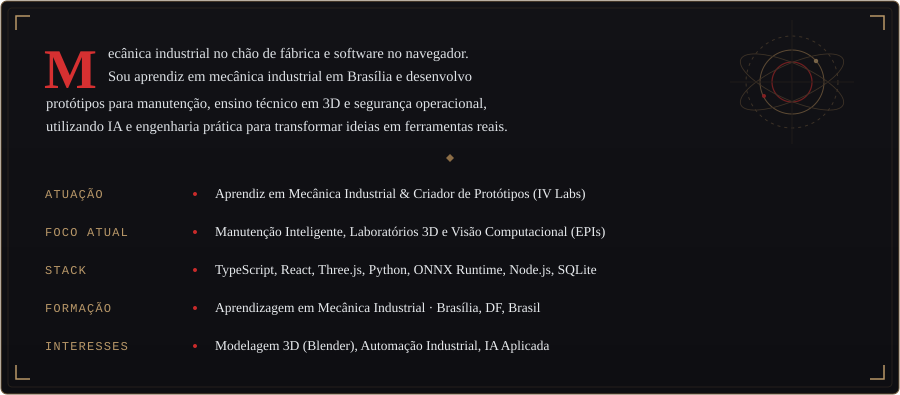

  

  <em>Mecânica industrial no chão de fábrica e protótipos inteligentes no navegador.</em>

  
  
  

---

### `/// SOBRE`

  

---

### `/// PROJETOS EM DESTAQUE`

| Projeto | Foco | Acesso |
| :--- | :--- | :--- |
| **Maintenance Intelligence 360** | Plataforma visual de manutenção com histórico por máquina, registro móvel e relatório diário | [Demo](https://maintenance-360-demo.netlify.app/) · [Código](https://github.com/italovienna-sketch/maintenance-intelligence-360) |
| **Mecânica Lab** | Plataforma educacional interativa com oficina 2D, laboratório 3D e simuladores | [Demo](https://mecanica-lab-3d.netlify.app/) · [Código](https://github.com/italovienna-sketch/mecanica-lab) |
| **VisionSafe AI** | Prova de conceito de verificação de EPIs pela câmera do celular com processamento local | [Demo](https://visionsafe-ai-demo.netlify.app/) · [Código](https://github.com/italovienna-sketch/visionsafe-ai) |

*Todos os projetos são iniciativas pessoais e independentes, com dados fictícios para demonstração.*

---

### `/// ARSENAL`

  

 

  

  
  
  

