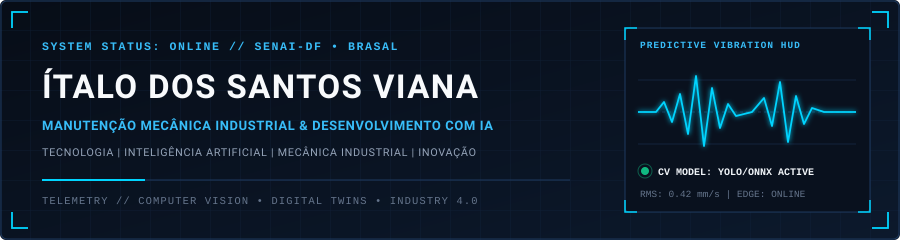

  

  <em>Bridging Industrial Mechanical Engineering with Computer Vision, Edge AI, and 3D Digital Twins</em>

  
  
  
  

---

### `// ENGINEERING_PROFILE`

  

---

### `// FEATURED_PROTOTYPES`

| Project | Domain | Links |
| :--- | :--- | :--- |
| **Maintenance Intelligence 360** | Visual maintenance management, asset history & daily field telemetry | [Live Demo](https://maintenance-360-demo.netlify.app/) · [Repository](https://github.com/italovienna-sketch/maintenance-intelligence-360) |
| **Mecânica Lab** | Interactive 2D workshop & 3D mechanical laboratory simulators | [Live Demo](https://mecanica-lab-3d.netlify.app/) · [Repository](https://github.com/italovienna-sketch/mecanica-lab) |
| **VisionSafe AI** | Edge computer-vision PPE verification via mobile camera (ONNX) | [Live Demo](https://visionsafe-ai-demo.netlify.app/) · [Repository](https://github.com/italovienna-sketch/visionsafe-ai) |

---

### `// TECH_STACK_&_TOOLS`

  

 

  

  
  
  
  

